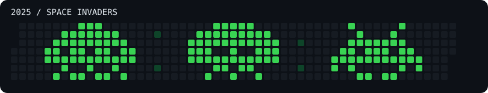

# 2025 contribution art: Space Invaders

Intentional pixel art for [davlabs-us’s 2025 contribution graph](https://github.com/davlabs-us?tab=overview&from=2025-01-01&to=2025-12-31).

These commits are decorative, backdated art pixels, not a record of software work performed in 2025. Author and committer timestamps are set to noon UTC on each painted day. The art lives on the default `main` branch in this standalone repository.

`art.json` records the exact dates and counts. `generate.py` creates a fresh repository with a randomized arrangement of three retro alien sprites. To recreate it, copy the generator into an empty directory and run `python3 generate.py`. Do not push another copy to the same account, because its contributions would add to this one.

To remove this artwork from the contribution graph, delete this dedicated repository on GitHub; GitHub may take time to recalculate the graph.
